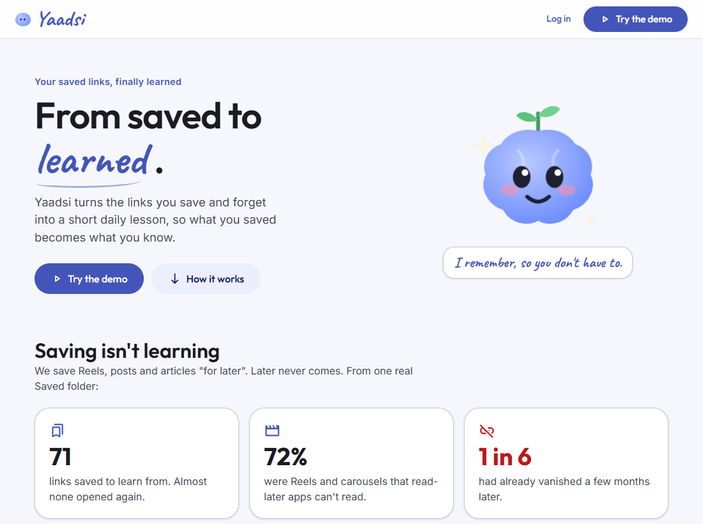
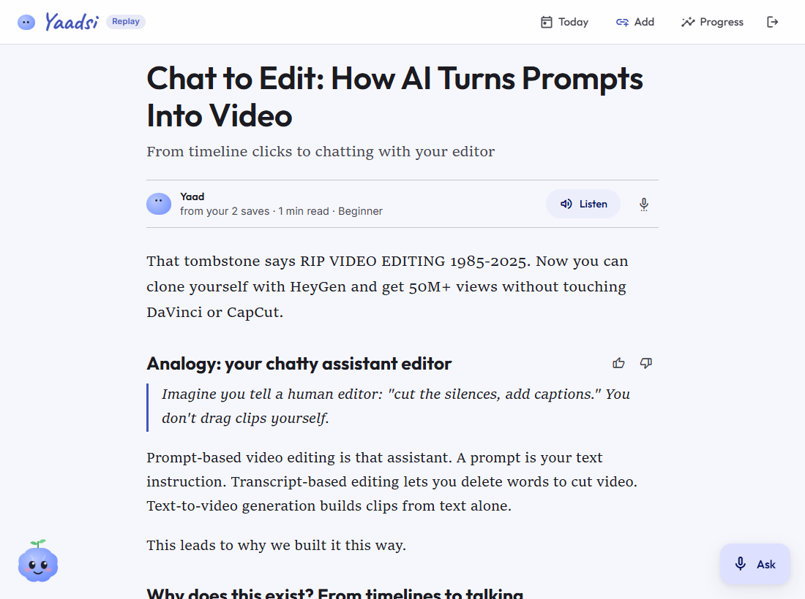

# Yaadsi: from saved to learned

**Yaadsi turns the links you save and forget into a short daily lesson, so what you saved becomes what you know.**

Built for the Meta Global AI Developer Hackathon (Indie track, "Build for Your World") with Muse Spark Open and the Meta Model API.

**Try it live: [yaadsi.vercel.app](https://yaadsi.vercel.app/)** and press **Try the demo**. It opens on 24 public demo saves. You can add your own link (LinkedIn, GitHub or an article; Instagram usually blocks cloud servers) and get a lesson from it in about 20 seconds. Everyone shares one demo space, it resets now and then, and live features stop for the day after a small spend cap.

**Or run it locally in one minute:** clone, `pip install -r requirements.txt`, run with `TUTOR_DATA=demo` (see [Run it](#run-it)), press **Try the demo**. No API keys needed.

| Landing | Today: your backlog and a 15-minute pick | A lesson from your saves |
|---|---|---|
|  |  |  |

## Vision

**A personal knowledge layer between you and the internet.** You keep saving the way you already do, and everything you save is kept, understood, connected, found again and taught back to you:

**Capture → Understand → Connect → Retrieve → Learn → Apply**

In the full product, Yaadsi is a chat contact: share a link to it on Telegram or WhatsApp, and the job is done. Most "second brain" tools stop at storing and searching. But a pile of links only turns into value when you learn from it, so this project builds that half: **Learn**, on top of Understand, Connect and Retrieve.

*Yaad* is Hindi for memory, and *yaad-si* means "a faint memory": the thing you only half-remember. Yaadsi remembers, so you don't have to.

## The problem

Every day we save Reels, posts and articles "for later": Instagram Saved, LinkedIn, our own WhatsApp chat. Later never comes.

I checked my own: **71 links saved to learn from, almost none opened again.**
- **72%** were Instagram carousels and Reels: images and video, which read-later apps can't read at all.
- **Captions alone** made only 55% of those Instagram saves understandable. The real content was on the slides.
- **One in six** had already disappeared a few months later, deleted or made private.

Saved folders *store* links. Nothing *teaches* them back to you, and the pile only grows.

## How Yaadsi solves it

Keep saving. Yaad, a small study buddy, turns the pile into a daily habit:

1. **Understand everything you saved**, including images and video. Each save gets a topic, a reading time, a difficulty and a short analysis of what it teaches.
2. **Decide what to learn today**, so you never face the whole pile at once. You get one coherent 15-minute bite from your own backlog.
3. **Teach it at your level**, from your saves only, with links back to the originals.
4. **Make it stick** with a quiz, an optional teach-back and spaced review right before you'd forget.
5. **Find it again from half-memory**, and see how it all connects.

## Features

- **Today home:** your backlog in five numbers (Saved, Learned, Waiting, Fading, Gone) and a daily 15-minute pick, such as one deep read plus one quick save on the same topic. **Gone** lists the posts that vanished before you learned them. **Fading** brings back what's due for review.
- **Lessons that read like an article:** a title and subtitle, a hook, sections built from first principles, one analogy, and a pull-quote takeaway. Each lesson shows the creator's real diagram cropped from the slide you saved, a simple picture of the idea, a diagram, and a quiz.
- **Make it your way:** at the end of each lesson, choose images, diagram, quiz and audio, and set the depth from 1 to 5. Too easy? The same saves come back in more depth. Thumbs up or down on each section teach Yaad your style.
- **Teach-back:** explain the idea in your own words, typed or spoken. Muse Wonder says what you got right, what you missed, and asks one follow-up.
- **Spaced review:** a Leitner schedule (1, 3, 7 and 21 days), with a 2-minute review on Today when something is fading.
- **Ask from half-memory:** "that Reel about writing video prompts as JSON". Ask by typing or by voice, and get an answer with the source cards to open.
- **Connect the dots:** one topic across all your saves. You see the core ideas, where your creators agree and disagree, what's missing, and the order to learn it in.
- **Your saves as a map:** a graph of topics and saves. Tap a topic to see its saves, then open one or learn it.
- **Add a link any time:** Yaad reads it, files it under a topic and can teach it.
- **Open the original:** every save links back to its source, or is marked "No longer online".

## AI: Meta models, each with one job

| Model | Job |
|---|---|
| **Muse Spark Open** (Baseten) | The brain: writes the lessons, analyses each save, picks Today, reads new links, answers questions, Connect the dots. Its streamed reasoning shows live as "Yaad is thinking…". It also reads carousel slides with vision. |
| **Muse Wonder** | The judge: picks the best of 3 lesson drafts (its reason is stored in each lesson's `judge` field), and grades your teach-back. |
| **SAM 3.1** | Finds and crops the real diagram out of the carousel slide you saved. |
| **Muse Image** | Draws a simple picture of each lesson's core idea. |
| **Muse Voice Transcribe** | Turns your spoken question or teach-back into text. |

If Baseten fails, brain calls fall back to Muse Spark 1.3 on the Meta Model API. Every call is written to a cost log.

**How it uses Spark Open's strengths:**

| | Measured |
|---|---|
| Whole-brain context: every save in one prompt | about 39k tokens, placed first in every call so Baseten serves it from the prompt cache |
| Ask across everything | about 1¢ a question once the prefix is cached |
| A lesson (best of 3, judged) | about 4¢ |
| Opening today's lesson | 0.3 s: built in the background before you click |
| First live "thinking" line | 0.3 s after you ask |
| Connect the dots for a topic | about 21 s, about 7.5¢ uncached |
| Add a new link | about 10 s, under 1¢ |

**Disclosure:** most of the slide OCR and the Reel briefs in my saved corpus were made before the hackathon, by my own research probe with another provider. Muse Spark Open read the slides that probe missed. All generation, judging, image, segmentation and voice work in the app runs on the Meta models above.

## Agents

Yaad doesn't answer from a single prompt. It works with tools:

- **The tool loop** ([agent.py](agent.py)): Muse Spark Open calls tools until it can answer in structured JSON. The tools ([tools.py](tools.py)) are `read_save`, which reads one save's full content, your note and its concepts, and `search_saves`, which finds related material across your other saves. Every step is recorded as an `agent_trace`, and the steps stream live as Yaad's thinking lines.
- **Lessons** ([lesson.py](lesson.py)): the day's saves go into the prompt, and the agent may search and read related saves (up to 6 steps). A repair pass and a tightening pass follow. This runs three times in parallel, and **Muse Wonder** picks the best draft ([improve.py](improve.py)). Your thumbs and feedback become style rules that steer the next lessons, which is self-improvement without training.
- **Ask** ([ask.py](ask.py)) picks one of two strategies:
  - Broad questions ("across my saves…") read the whole brain in one cached call.
  - Lookups ("that reel about…") use keyword search plus the tool loop (up to 4 steps).

  If one fails, the other takes over. Answers cite the saves they used.
- **Connect the dots** ([masterclass.py](masterclass.py)): one deep-reasoning pass over a whole topic, run in the background because high effort takes a minute or two.
- **Background builds** ([prewarm.py](prewarm.py)): Yaad builds upcoming lessons before you open them, so Start is instant.

## Voice

- **Speak to Yaad:** the mic in **Ask** and in **Teach-back** records in the browser, converts the recording to 16 kHz mono WAV (up to 30 s), and sends it to **Muse Voice Transcribe**. The text then goes through the same Ask or teach-back pipeline. The upload size is capped before the server reads the body.
- **Yaad speaks back:**
  - **Listen** reads the lesson aloud.
  - The diagram can narrate itself step by step.
  - Answers can be spoken.

  These use the browser's built-in speech, one voice at a time, and the Yaad character's mouth moves while it talks.

## Honest evals

- **OCR is what makes Instagram learnable.** Captions alone made 55% of my Instagram saves understandable; with slide OCR and Reel briefs, 80%.
- **Ask:** 12/12 on imperfect-memory lookups ("that reel where a guy makes a drone shot from one photo"), for both modes. Keyword search is faster (3.6 s vs 5.2 s), so it handles single-save lookups. Questions that span many saves read everything, which links more saves.
- **Blind test**: the full system (best of 3, judged by Wonder) against one plain draft. Each pair had the same save and level, with sides shuffled, on 8 pairs:
  - I preferred the full system **6 to 2**.
  - Muse Wonder, judging each pair in both orders, scored it **3 wins, 2 losses, 3 ties**. Wonder also picked the full system's drafts, so its vote isn't independent.
  - My picks and Wonder's matched on only 1 of 8 pairs. With n = 8, we read this as a lead, not proof.

## Run it

```bash
python -m venv .venv
.venv/Scripts/activate            # Windows; on macOS/Linux: source .venv/bin/activate
pip install -r requirements.txt
TUTOR_DATA=demo python -m uvicorn app:app --port 8765    # PowerShell: $env:TUTOR_DATA="demo"; python -m uvicorn ...
```

Open http://127.0.0.1:8765 and press **Try the demo**. It uses a mock login (admin / admin) that only switches between the
landing page and the app; there is no real authentication yet.

- **Without keys** it runs in **replay mode**: the lessons, answers and Connect-the-dots that Yaad already made for the demo saves open instantly. Anything new asks for keys.
- **To go live**, copy `.env.example` to `.env` and add a Baseten key (Muse Spark Open) and a Meta Model API key.

The demo corpus (`demo/`) holds 24 public posts by other creators on software, AI, careers and design. Each keeps only a short excerpt and Yaad's own analysis. My personal saves are not in this repo, and `make_demo.py --check` blocks anything personal from entering it.

The demo lessons and their Muse Image pictures were made the same way a live lesson is (three Spark Open drafts, Muse Wonder picks one), by the [Remake demo lessons](.github/workflows/remake-demo.yml) workflow, since my office network can't reach the Meta API. Each lesson keeps Wonder's reason in its `judge` field.

**The hosted demo** ([app.py](app.py), `HOSTED`) runs on Vercel. It turns on by itself when Vercel's `VERCEL` variable is set:
- **without keys:** the replay demo;
- **with keys:** live, working on a copy of the demo in `/tmp`, with a daily spend cap (`TUTOR_DAILY_USD`, default $3).

## Architecture

```
saves (link / note) ──► read: fetch (SSRF-safe) · OCR · Reel brief ──► studio: topic, minutes, difficulty
                                                                         │
                 ┌───────────────────────────────────────────────────────┘
                 ▼
  Today: backlog numbers + daily pick ──► lesson agent (Spark Open + tools, best of 3 judged by Wonder)
                 │                              ├─ real diagram (SAM 3.1) + simple picture (Muse Image)
                 │                              └─ quiz · teach-back (Wonder) ─► spaced review (Leitner) ─► "fading" on Today
  Ask (text or voice: Voice Transcribe) ──► whole-brain prompt (cached prefix) or keyword search + tool loop
  Connect the dots ──► one topic across all saves, learning order
```

- **Stack:** FastAPI and vanilla JS, with no build step and no database. Everything is JSON files under `TUTOR_DATA`, and generated results are cached by content hash.
- **Safety:**
  - Model text is only ever rendered as text, never as HTML.
  - Fetching a new link blocks private, loopback and NAT64 addresses, re-checks every redirect, and caps size and time.
  - Content from a link is treated as data, not instructions.
  - **Locally:** every POST needs a custom header, and only localhost hosts are accepted, so other web pages can't spend your keys.
  - **On Vercel:** `*.vercel.app` is also allowed, under the daily spend cap.

## What's next

This web app is the learning half of **Yaadsi** (yaadsi.com).

1. **Capture where people already share:** Telegram first, then WhatsApp. Share a link and get a daily nudge with today's lesson. The nudge on the Today screen is marked "coming" because it isn't built into this demo.
2. **Real accounts and private storage per user,** replacing the mock login (one demo account) and the shared demo space.
3. **Apply:** turning what you learned into projects and checklists, the last step of the lifecycle.

*Yaad si hai? Yaadsi pe hai.* "Half-remember it? Yaadsi has it."
