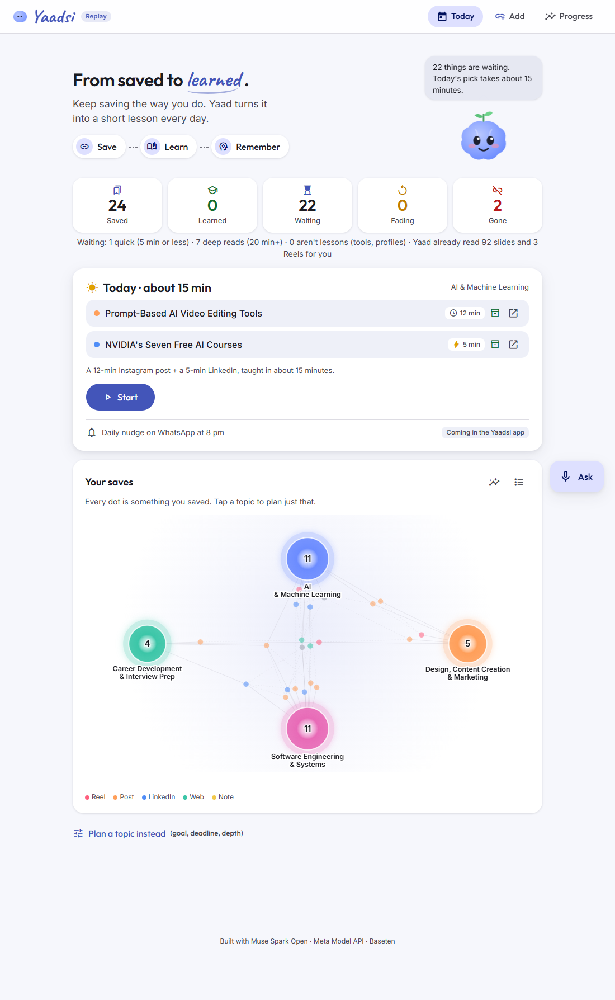

# Yaadsi: from saved to learned

**Yaadsi turns the links you save and forget into a short daily lesson, so what you saved becomes what you know.**

Built for the Meta Global AI Developer Hackathon (Indie track, "Build for Your World") with Muse Spark Open.



## The problem

Every day we save Reels, posts and articles "for later": Instagram Saved, LinkedIn, our own WhatsApp chat. Later never comes.

I checked my own: **71 links saved to learn from, almost none opened again.**
- **72%** were Instagram carousels and Reels: images and video, which read-later apps can't read at all.
- **One in six** of those Instagram saves had already disappeared, deleted or made private, a few months later.

Saved folders *store* links. Nothing *teaches* them back to you.

## What Yaadsi does

Keep saving the way you already do. Yaad, a small study buddy, does the rest:

1. **Reads everything you save**, even carousels (every slide, by OCR) and Reels (a short brief). Each one is filed by topic, with its time to read and its difficulty.
2. **Plans your backlog for you.** The home screen shows the pile in numbers: saved, learned, waiting, fading, gone. Every day it picks a coherent 15-minute bite: one deep read plus one quick save from the same topic. No setup.
3. **Teaches it at your level, from your own saves.** It uses the real diagram, cropped out of the post you saved, next to a kid-simple picture. Then a quiz, with a teach-back you can do if you want.
4. **Checks you remember**, right before you'd forget: spaced review on a Leitner schedule (1, 3, 7, 21 days).
5. **Answers "that Reel about system design last month"**: ask in words or by voice, across everything you saved.
6. **Connects the dots**: one topic across all your saves. It shows what agrees, what disagrees, what's missing, and the order to learn it in.

## Meta models, each with one job

| Model | Role |
|---|---|
| **Muse Spark Open** (Baseten) | The brain: lessons, plans, answers, Connect the dots, reading new links. Its live reasoning streams as "Yaad is thinking". |
| **Muse Wonder** | The judge: picks the best of 3 drafted lessons, and grades your teach-back. |
| **SAM 3.1** | Crops the real diagram out of the carousel slide you saved. |
| **Muse Image** | Draws a simple picture of the idea. |
| **Muse Voice Transcribe** | Ask Yaad a question out loud. |

## How it uses Spark Open's strengths

| | Measured |
|---|---|
| Whole-brain context: every save in one prompt | about 39k tokens, put first in every call so it's served from Baseten's prompt cache |
| Ask across everything | about 1¢ a question once the prefix is cached |
| A lesson (best of 3, judged) | about 4¢ |
| Opening today's lesson | 0.3 s: built in the background before you click |
| First live "thinking" line | 0.3 s after you ask |
| Connect the dots for a topic | about 21 s, about 7.5¢ uncached |
| Add a new link | about 10 s, under 1¢ |

## Honest evals

- **OCR is what makes Instagram learnable.** Captions alone made 55% of my Instagram saves understandable; with slide OCR and Reel briefs, 80%.
- **Ask:** 12/12 on imperfect-memory lookups ("that reel where a guy makes a drone shot from one photo"), for both modes. Keyword search is faster (3.6 s vs 5.2 s), so it handles single-save lookups. Questions that span many saves read everything, which links more saves.
- **Blind test**: the full system (best of 3, judged by Wonder) against one plain draft. Each pair had the same save and level, with sides shuffled, on 8 pairs:
  - I preferred the full system **6 to 2**.
  - Muse Wonder, judging each pair in both orders, scored it **3 wins, 2 losses, 3 ties**. Wonder also picked the full system's drafts, so its vote isn't independent.
  - My picks and Wonder's matched on only 1 of 8 pairs. With n = 8, we read this as a lead, not proof.

## Run it

```bash
python -m venv .venv
.venv/Scripts/activate            # Windows; on macOS/Linux: source .venv/bin/activate
pip install -r requirements.txt
TUTOR_DATA=demo python -m uvicorn app:app --port 8765    # PowerShell: $env:TUTOR_DATA="demo"; python -m uvicorn ...
```

Open http://127.0.0.1:8765 and press **Try the demo**. It uses a mock login (admin / admin) that only switches between the
landing page and the app; there is no real authentication yet.

- **Without keys** it runs in **replay mode**: the lessons, answers and Connect-the-dots that Yaad already made for the demo saves open instantly. Anything new asks for keys.
- **To go live**, copy `.env.example` to `.env` and add a Baseten key (Muse Spark Open) and a Meta Model API key.

The demo corpus (`demo/`) holds 24 public posts by other creators on software, AI, careers and design. Each keeps only a short excerpt and Yaad's own analysis. My personal saves are not in this repo.

## Architecture

```
saves (link / note) ──► read: fetch (SSRF-safe) · OCR · Reel brief ──► studio: topic, minutes, difficulty
                                                                         │
                 ┌───────────────────────────────────────────────────────┘
                 ▼
  Today: backlog numbers + daily pick ──► lesson (Spark Open, best of 3 judged by Wonder)
                 │                              ├─ real diagram (SAM 3.1) + simple picture (Muse Image)
                 │                              └─ quiz ─► spaced review (Leitner) ─► "fading" back on Today
  Ask (text or voice) ──► whole-brain prompt (cached prefix) or keyword search
  Connect the dots ──► one topic across all saves, learning order
```

- **Stack:** FastAPI and vanilla JS, with no build step and no database. Everything is JSON files under `TUTOR_DATA`, and generated results are cached by content hash.
- **Safety:**
  - Model text is only ever rendered as text, never as HTML.
  - Fetching a new link blocks private, loopback and NAT64 addresses, re-checks every redirect, and caps size and time.
  - Every POST needs a custom header, and only localhost hosts are accepted, so other web pages can't spend your keys.
  - Content from a link is treated as data, not instructions.

## What's next

This web app is the learning half of **Yaadsi** (yaadsi.com). The capture half is a Telegram bot, and WhatsApp next: you share a link the way you already do, and get a daily nudge with today's lesson. The nudge shown on the Today screen is marked "coming" because it isn't built into this demo.

*Yaad* means memory in Hindi. Yaadsi remembers, so you don't have to.
